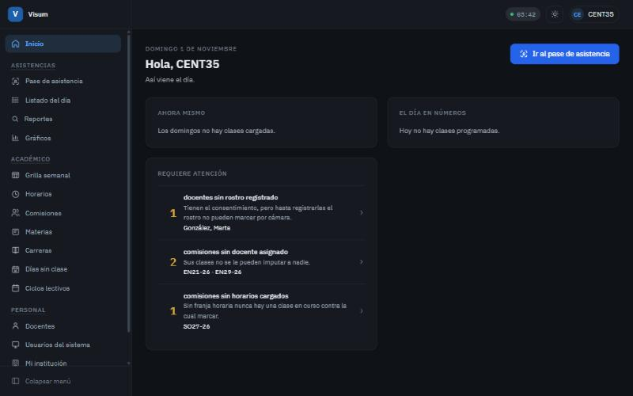
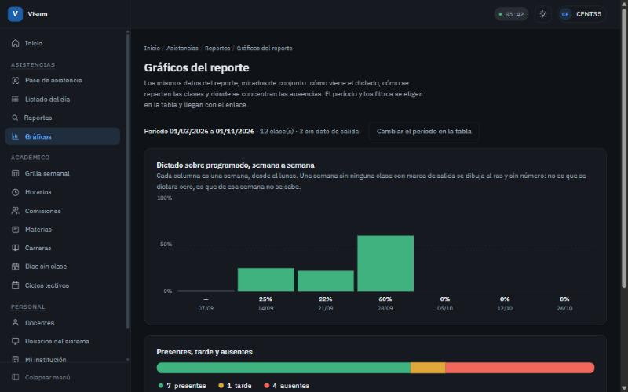

# Visum

Asistencia docente por reconocimiento facial, para institutos y universidades.

[](https://github.com/fran-q/asistencias-docente/actions/workflows/ci.yml)






<sub>Capturas de la aplicación con datos de ejemplo.</sub>

---

## El problema

La asistencia docente se controla con una planilla de papel donde cada uno firma al llegar.
Depende de la buena fe, se puede firmar por otro, y para saber cuántas clases se dictaron el mes
pasado hay que sentarse a digitalizar planillas.

Visum reemplaza esa planilla. Una cámara en secretaría, el docente se para enfrente dos segundos,
y el sistema lo identifica, cruza la hora con los horarios cargados, determina qué clase le
corresponde y registra la marca. El dato queda disponible en el momento.

## Qué hace

- **Toma asistencia por reconocimiento facial.** El docente no usa el sistema: se para frente a
  la cámara y sigue de largo.
- **Registra entrada y salida.** No solo si vino: cuánto de la clase estuvo.
- **Genera las ausencias solo.** Un proceso cierra el día y asienta lo que nadie marcó.
- **Admite corregir a mano.** Cuando el reconocimiento no acierta, un administrador carga la
  marca indicando el motivo, y queda registrado quién la cargó.
- **Modo desatendido.** El equipo puede tomar asistencia sin que haya nadie con sesión abierta.
- **Reportes.** Minutos dictados sobre programados, filtros por docente, materia, carrera y
  período, con gráficos y exportación a CSV y PDF.
- **Varias instituciones sobre una instalación**, con aislamiento total entre ellas.

## Privacidad y datos biométricos

El sistema procesa rostros, que son datos sensibles. Esto es lo que hace al respecto:

- **No se almacenan fotografías.** Solo el modelo biométrico derivado, comprimido y cifrado con
  AES-256-GCM. Los cuadros que llegan de la cámara se descartan apenas se entrena el modelo.
- **Consentimiento previo, versionado y revocable.** Sin consentimiento vigente no se registra ni
  se usa un rostro. Revocarlo da de baja el modelo y lo expulsa de la memoria en el acto.
- **Derecho de supresión.** El docente puede pedir el borrado de su dato biométrico y llevarse
  una constancia en PDF de qué se borró, cuándo y quién lo hizo. El borrado es físico: una fila
  inactiva seguiría conteniendo el dato.
- **La captura ocurre en equipos conocidos.** Tomar asistencia y registrar un rostro solo funciona
  desde una computadora que la institución autorizó expresamente.

Rige la Ley argentina N° 25.326 de Protección de Datos Personales y la Resolución AAIP N° 255/2022,
que incluye a los datos biométricos entre los datos sensibles.

## Probarlo

Hace falta Java 21 y una base MariaDB.

```bash
git clone https://github.com/fran-q/asistencias-docente.git
cd asistencias-docente
./gradlew bootRun
```

Arranca en `http://localhost:8080` con el perfil `local`, que espera las credenciales de la base
en `src/main/resources/application-local.properties` (no versionado). Flyway crea el esquema en
el primer arranque.

Para correr las pruebas, que no necesitan base porque usan H2 en memoria:

```bash
./gradlew test
```

## Cómo está hecho

| | |
|---|---|
| Backend | Java 21 · Spring Boot 3.5 · Spring Security |
| Vistas | Thymeleaf renderizado en el servidor |
| Base | MariaDB · Flyway para el esquema |
| Visión | JavaCV 1.5.11 · OpenCV 4.10 · reconocedor LBPH |
| Build | Gradle · GitHub Actions |

Es un monolito modular organizado por capas. El multi-tenancy se resuelve con un discriminador
por columna y cuatro capas de aislamiento, no con una base por institución.

El reconocimiento usa LBPH y no embeddings de aprendizaje profundo: corre sin GPU, sin servicios
externos y sin enviar ningún rostro fuera de la máquina. Para aceptar una identificación exige
dos condiciones a la vez — distancia por debajo de un umbral calibrado, y una diferencia mínima
contra el segundo candidato — porque el reconocedor siempre devuelve el más parecido aunque el
parecido sea malo.

Todo el stack es software libre, sin costo de licencia.

## Desplegar

**En un servidor.** Docker Compose levanta la aplicación, MariaDB y Caddy, que resuelve el
certificado solo:

```bash
cd despliegue
./generar-secretos.sh
docker compose up -d
```

La cámara necesita HTTPS: `getUserMedia` solo funciona en un contexto seguro.

**En la institución, sin internet.** Hay un instalador de Windows que lleva todo adentro —la
aplicación, Java y la base— y la deja corriendo como servicio. En esa modalidad el sistema no
envía correos: la primera cuenta se crea en un asistente de primer arranque y la contraseña se
recupera con una clave que entrega la instalación. Los scripts están en `instalador/`.

## Licencia

MIT. Ver [LICENSE](LICENSE).
